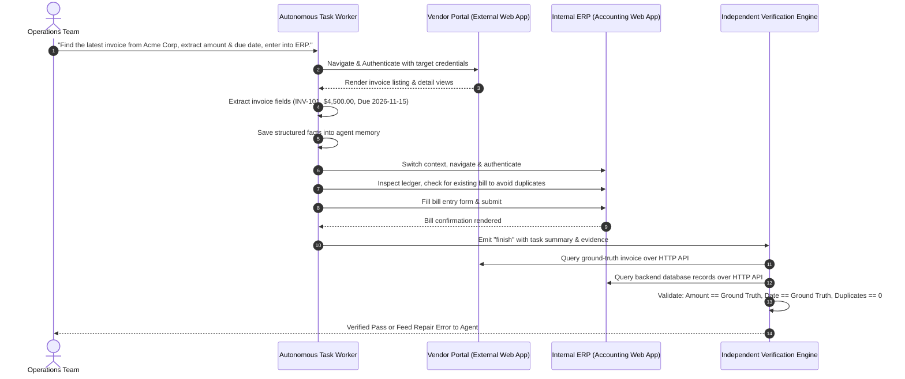

# Autonomous AI Task Worker — Core Idea & Vision

## 1. Executive Summary

Modern enterprise operations are overwhelmed by repetitive, cross-system tasks that require moving critical data between disjointed web applications—such as reading invoices from external vendor portals, extracting accounting fields, cross-referencing records, and inputting structured bills into internal Enterprise Resource Planning (ERP) or accounting systems.

Traditional automation approaches have historically failed at this problem:
1. **Traditional Robotic Process Automation (RPA):** Relies on hardcoded selectors, pixel coordinates, or fragile desktop scripts. Even trivial frontend changes, dynamic CSS class renames, or transient loading delays break RPA scripts entirely.
2. **Computer Vision (CV) AI Agents:** Capture high-resolution full-page screenshots and stream them to multimodal LLMs. While flexible, CV agents are prohibitively expensive ($0.05–$0.20+ per step), suffer from high latency (3–8s per step), and frequently hallucinate coordinate clicks or misread tiny typography.

**The Autonomous AI Task Worker** was conceived to solve this dilemma: a lightweight, self-healing, cross-application browser automation agent powered by **structured DOM accessibility snapshots** (not computer vision), backed by **zero-trust independent verifiers**, an **intelligent multi-provider LLM fallback chain**, and **automated chaos recovery**.

---

## 2. The Core Problem Statement

Enterprises need digital workers that behave like conscientious human employees:
- **Resilient to Chaos:** Real enterprise websites encounter transient 500/502 errors, cold starts, session timeouts, unexpected popups/modals, slow networks, and first-attempt validation hiccups.
- **Accurate and Honest:** LLMs naturally suffer from hallucinations and confirmation bias. When an agent believes it has entered a bill, that claim cannot be trusted without objective verification.
- **Cost and Latency Efficient:** Tasks must complete in seconds, not minutes, without exhausting monthly API budgets on raw pixels.
- **Safe & Governed:** Financial systems cannot permit unauthorized duplicate payments, unauthorized overwrites, or data leaks.

---

## 3. The Flagship Workflow

The base workflow modeled by this system is the **Cross-Application Invoice-to-ERP Reconciliation Pipeline**:

---

## 4. Key Architectural Pillars

### Pillar I: DOM Accessibility Snapshots over Computer Vision
- Instead of taking screenshots and running heavy visual OCR models, the agent inspects the web page through a **Playwright-powered DOM accessibility tree**.
- Interactive elements (buttons, inputs, links, dropdowns) are assigned numbered tags (`[e1]`, `[e2]`, `[e3]`), along with role, label, and state.
- **Benefits:**
  - Token consumption drops by **>85%** per step.
  - LLM inference latency drops from 4000ms+ down to 400–800ms.
  - Zero coordinate-guessing: actions target unambiguous element IDs (`click element="e3"`).

### Pillar II: Independent Verifiers & Zero-Trust Architecture
- **Never trust the agent's self-assessment:** The model emitting `{"action": "finish"}` does not constitute task completion.
- When `finish` is called, an **Independent Verifier (`InvoiceEntryVerifier`)** inspects the live application backends over HTTP:
  - **Portal Verification:** Was the requested vendor and invoice actually found?
  - **ERP Ledger Check:** Was a matching bill created in the ERP?
  - **Value Equality:** Do the recorded amount and due date match the portal source to the exact decimal?
  - **Duplicate Guard:** Did the agent accidentally create more than 1 bill for the same invoice?
  - **Precondition Check:** Were any unintended writes executed during edge cases (e.g. non-existent invoices)?
- If verification fails, the verifier generates actionable diagnostic diffs and grants the agent a bounded single-repair cycle to correct the discrepancy.

### Pillar III: High-Availability Multi-Provider LLM Chain
- Enterprise automation cannot halt because an individual LLM provider is experiencing a quota rate limit, 503 outage, or maintenance window.
- The system orchestrates an automatic fallback cascade:
  1. **Primary Tier:** Fast, cost-effective models (e.g., Google Gemini 2.5/1.5 Flash).
  2. **Secondary Tier:** High-throughput open-weight inference (e.g., Groq Llama 3.3 70B / Qwen 2.5).
  3. **Tertiary Tier:** OpenRouter aggregator models for maximum availability.
  4. **Deterministic Tier:** Scripted offline providers for CI/CD test automation.
- **Intelligent Error Classification:** Differentiates permanent configuration errors (`config_error` - bad API key or missing package) from quota limits (`quota_daily`, `quota_minute`). Quota-limited models enter automatic cooldowns and reset at midnight Pacific without crashing the worker.

### Pillar IV: Enterprise Chaos Resilience & Tool-Level Recovery
- Rather than burning expensive LLM steps on network glitches, the browser layer handles transient turbulence autonomously:
  - **Cold Start Warmup:** Target services are probed before run execution (up to 90s) to handle serverless or cloud spin-up delays.
  - **HTTP 5xx Recovery:** Cloud 502/504 Bad Gateway pages trigger tool-level bounded retries with exponential backoff without incrementing the LLM step budget.
  - **Modal & Popup Busting:** Transient promotional modals, session warnings, or alert popups are detected and cleared.
  - **Dead-End Detection:** If a bad link returns a 404 or unparseable page, the agent automatically retreats to `last_good_url`.

### Pillar V: Human-in-the-Loop (HITL) for Ambiguity & Safety
- **Ambiguity Resolution:** When an agent encounters ambiguous business situations (e.g., two invoices with identical vendor names or duplicate entries), it invokes `ask_human`. Execution cleanly suspends and presents an interactive prompt to an operator.
- **High-Risk Action Approvals:** Sensitive actions (e.g., financial ledger modifications or batch deletions) can require human confirmation before execution.
- **Safety Interceptions:** Attempts to ask humans for passwords or credentials already declared in the environment are automatically intercepted and redirected to `browser.login` with zero step penalty.

### Pillar VI: Real-Time Observability & Replayability
- **Streaming Telemetry:** Uses lightweight Server-Sent Events (SSE) instead of complex WebSocket infrastructure to stream live thought processes, actions, DOM updates, and latency metrics to an interactive browser dashboard.
- **Execution Tracing:** Every execution records a complete, reproducible JSONL log under `runs/<id>/trace.jsonl`.
- **Session Replay:** Any past run—successful, failed, or simulated—can be replayed interactively in the web dashboard at variable playback speeds (1x to 100x) for debugging, compliance, and demonstration.

---

## 5. Long-Term Vision

The Autonomous AI Task Worker serves as the foundation for **Autonomous Enterprise RPA**:
- Dynamic skill acquisition: Remembering patterns across recurring weekly workflows.
- Multi-agent coordination: One agent monitoring email/webhooks, dispatching tasks to dedicated specialized workers.
- Cross-cloud deployment: Seamless execution across local developer workstations, Dockerized private VPCs, and serverless hosting environments.
